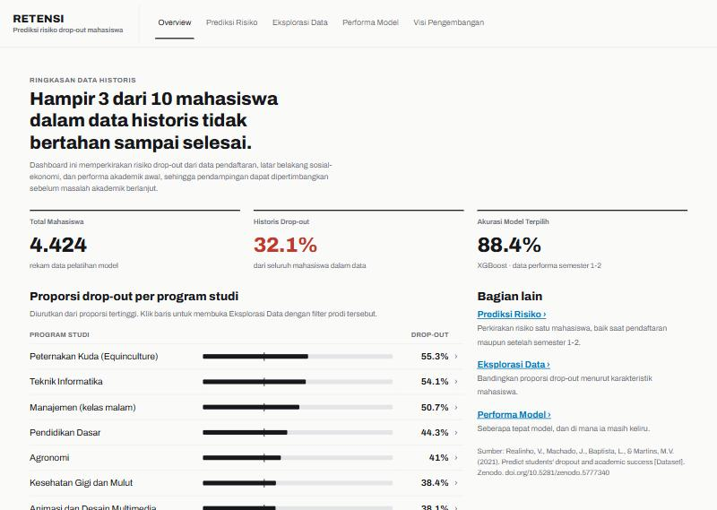
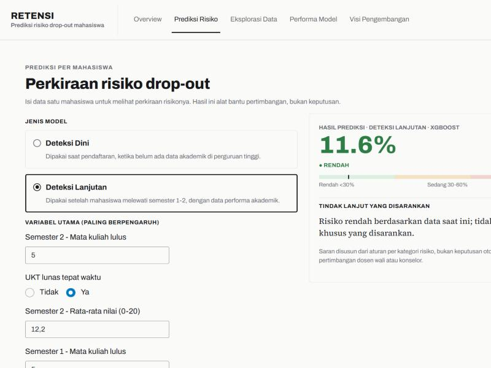
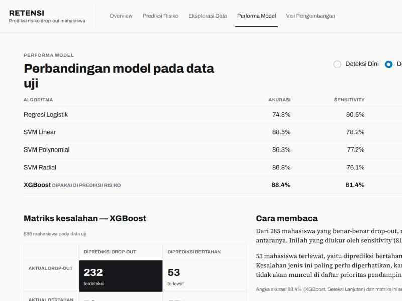

# RETENSI — Prediksi Risiko Drop-Out Mahasiswa

**[🔗 Coba dashboard-nya](https://salwaefendii.shinyapps.io/prediksi-dropout-mahasiswa/)**

Dashboard yang memperkirakan risiko seorang mahasiswa berhenti kuliah di tengah jalan (drop-out), supaya pendampingan bisa dipertimbangkan lebih awal — bukan setelah mahasiswa sudah benar-benar keluar.

---

## Problem

Hampir **1 dari 3 mahasiswa** dalam dataset yang dipakai di sini tidak bertahan sampai selesai studinya. Drop-out itu mahal — buat mahasiswa yang kehilangan waktu dan biaya, dan buat institusi yang kehilangan mahasiswa yang sebenarnya bisa dibantu kalau tandanya terdeteksi lebih awal.

Masalahnya, tanda-tanda itu sering baru kelihatan setelah terlambat: IP jeblok, kehadiran menurun, atau mahasiswa sudah berhenti bayar UKT berbulan-bulan. Pertanyaannya: **bisa nggak tanda-tanda itu diprediksi lebih awal**, dari data yang institusi sudah punya sejak hari pertama mahasiswa daftar?

## Approach

Dashboard ini dibangun di atas dataset **"Predict Students' Dropout and Academic Success"** (Realinho et al., 2021) — 4.424 mahasiswa, 37 variabel: data pendaftaran, latar belakang sosial-ekonomi (pendidikan & pekerjaan orang tua), dan performa akademik semester 1–2.

Dua model dilatih untuk dua titik waktu berbeda, karena data yang tersedia beda tergantung kapan pertanyaannya diajukan:

- **Deteksi Dini** — dipakai saat mahasiswa baru mendaftar, sebelum ada data akademik sama sekali.
- **Deteksi Lanjutan** — dipakai setelah mahasiswa melewati semester 1–2, saat performa akademik awal sudah bisa dilihat.

Lima algoritma dibandingkan untuk tiap model (Regresi Logistik, SVM dengan 3 kernel, dan XGBoost), divalidasi dengan 5-fold cross-validation, dengan penanganan *class imbalance* (bobot kelas, bukan cuma andalkan akurasi) dan seleksi fitur (RFE) yang dijalankan **setelah** data dibagi train/test — supaya hasil evaluasinya nggak bias karena "mengintip" data uji. **XGBoost** dipilih sebagai mesin prediksi utama, bukan karena akurasinya paling tinggi, tapi karena paling seimbang dalam menangkap mahasiswa yang benar-benar berisiko (*recall*/sensitivity-nya paling konsisten di kedua model).

Dibangun dengan **R Shiny** dan **bslib** (Bootstrap 5).

## Key Insight

**Status finansial/administratif ternyata prediktor lebih kuat daripada latar belakang keluarga** — setidaknya di titik pendaftaran. Model Deteksi Dini, kalau disuruh memilih sendiri variabel mana yang paling penting (lewat *Recursive Feature Elimination*), memilih status pembayaran UKT, status utang, beasiswa, program studi, dan jalur pendaftaran — **bukan** pendidikan atau pekerjaan orang tua, walau variabel itu tersedia.

Angkanya cukup tegas: mahasiswa yang **telat bayar UKT** punya tingkat drop-out **86,6%**, dibanding **24,7%** untuk yang bayar tepat waktu. Itu beda lebih dari 3 kali lipat — dan ini data yang institusi sudah punya sejak semester pertama, jauh sebelum nilai akademik jadi indikator.

Begitu data semester 1–2 tersedia, satu variabel tunggal — **jumlah mata kuliah yang lulus di semester 2** — menyumbang sekitar **40% dari seluruh kemampuan prediksi model**. Masuk akal: performa akademik awal adalah sinyal paling langsung soal apakah mahasiswa sedang kesulitan.

## Live Demo

🔗 **https://salwaefendii.shinyapps.io/prediksi-dropout-mahasiswa/**

Dashboard punya 5 bagian:
| Halaman | Isinya |
|---|---|
| **Overview** | Ringkasan data: total mahasiswa, tingkat drop-out historis, akurasi model, dan perbandingan antar program studi |
| **Prediksi Risiko** | Masukkan data satu mahasiswa (hipotetis), dapatkan perkiraan risiko drop-out + kategori + saran tindak lanjut |
| **Eksplorasi Data** | Bandingkan tingkat drop-out berdasarkan karakteristik mahasiswa (beasiswa, status UKT, usia, dll.) |
| **Performa Model** | Perbandingan 5 algoritma, matriks kesalahan, dan penjelasan cara membacanya |
| **Visi Pengembangan** | Konsep pengembangan lanjutan (belum diimplementasikan) — dari prediksi ke sistem pendampingan |

## Screenshots

**Overview — ringkasan data dan performa model**


**Prediksi Risiko — hasil untuk satu mahasiswa**


**Performa Model — perbandingan 5 algoritma**


---

## Untuk Developer

Struktur project ada di `dashboard_datmin/`:

```
dashboard_datmin/
├── app.R                      # Dashboard Shiny (bslib)
├── train_models.R             # Pipeline training (dijalankan manual)
├── data_prep.R                # Loading data + label kategori, dipakai bareng app.R & train_models.R
├── data_uci_full.csv          # Dataset (lihat sitasi di bawah)
├── model_results_dini.rds     # Model terlatih — pool Deteksi Dini
└── model_results_lanjutan.rds # Model terlatih — pool Deteksi Lanjutan
```

Jalankan lokal: buka `dashboard_datmin/app.R` di RStudio, klik **Run App**. Untuk melatih ulang model (misalnya setelah data berubah), jalankan `train_models.R` secara manual lebih dulu.

### Keterbatasan yang disengaja
- Model memprediksi **Dropout vs Bertahan** (Enrolled + Graduate digabung), bukan 3 kelas asli dataset — karena tujuan dashboard ini deteksi risiko keluar, bukan prediksi kelulusan.
- Dashboard tidak menyimpan data mahasiswa sungguhan, nama, atau status kontak — lihat halaman **Visi Pengembangan** untuk arah pengembangan ke sistem pendampingan nyata.

## Sitasi Dataset

> Realinho, V., Machado, J., Baptista, L., & Martins, M.V. (2021). *Predict students' dropout and academic success* (Version 1.0) [Dataset]. Zenodo. https://doi.org/10.5281/zenodo.5777340
